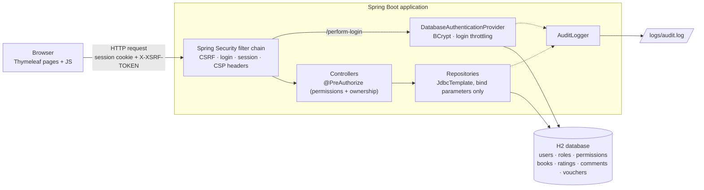
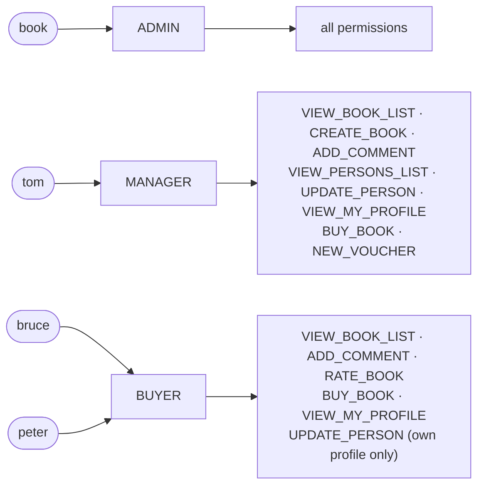

# Secure Bookshop · RBS 2024/2025


Course project for **Secure Software Development** (*Razvoj bezbednog softvera*, RBS) at the University of Belgrade, school year 2024/2025.

## About the project

The starting point was an **intentionally vulnerable web application**: a small online bookshop
(it literally shipped as *"Not very secure Bookshop"*) where users browse, rate, comment on and buy books,
and managers maintain the catalogue, users and discount vouchers.

The goal of the project was to **find the vulnerabilities, exploit them, and fix the application**
so that it is no longer exploitable. The work covered:

- **SQL injection**: every query built from user input
- **Cross-site scripting (XSS)**: stored and DOM-based
- **Cross-site request forgery (CSRF)**
- **Access control**: roles, permissions and per-object ownership rules
- **Logging and auditing**: who changed what, without leaking secrets
- **Authentication**: password storage and brute-force protection

The application was also analysed with **OWASP ZAP** and **SonarQube**, the tools used in the course.

## Architecture



### Role-based access control

Users get **roles**, roles get **permissions**, and every endpoint checks a permission
(`@PreAuthorize("hasAuthority('...')")`). Profile endpoints additionally check **ownership**,
so a buyer can edit only their own profile.



| Permission | Admin | Manager | Buyer |
|---|:---:|:---:|:---:|
| View and search books | ✓ | ✓ | ✓ |
| Add a book | ✓ | ✓ | |
| Comment | ✓ | ✓ | ✓ |
| Rate a book | ✓ | | ✓ |
| Buy a book | ✓ | ✓ | ✓ |
| View the user list | ✓ | ✓ | |
| View another user's profile | ✓ | | |
| Edit / delete a profile | any | any | own |
| Create vouchers | ✓ | ✓ | |

## Vulnerabilities and fixes

| Vulnerability | Where it was | Fix |
|---|---|---|
| **SQL injection** | Login, book and user search, ratings, comments, permissions: SQL built by string concatenation | All repositories use `JdbcTemplate` with bind parameters. `LIKE` wildcards are escaped. Voucher ownership is an exact match instead of `LIKE '%username%'` |
| **Stored XSS** | Comments rendered as raw HTML (`th:utext`) | Output encoding (`th:text`), comments stored as typed |
| **DOM XSS** | Search results, the search term and the user table written with `innerHTML` | `textContent` and `encodeURIComponent` |
| **XSS defence in depth** | Inline scripts everywhere | All scripts and styles moved to static files, strict **Content-Security-Policy** without `unsafe-inline` |
| **CSRF** | CSRF protection disabled, CORS allowed credentialed requests from another origin | Spring Security CSRF tokens (`X-XSRF-TOKEN` header for `fetch`), `SameSite=Strict` session cookie, CORS filter removed. See [`csrf-exploit/`](csrf-exploit) |
| **Broken access control** | Any signed-in user could call any endpoint | Users → roles → permissions, `@PreAuthorize` on every endpoint, ownership checks for profiles |
| **Plain-text passwords** | Passwords stored and compared as plain text, and written into the failed-login message | BCrypt (cost 12), identical error for unknown user and wrong password, a BCrypt check runs even for unknown usernames (no timing difference) |
| **Brute force** | Unlimited login attempts | Account locked for 15 minutes after 5 failed attempts |
| **Session security** | Session cookie readable from JavaScript, no rotation | `HttpOnly`, `SameSite=Strict`, new session id after login, 30 min timeout |
| **Insufficient logging** | No audit trail, and the logged user id was cached from the first request | Audit records (`userId` + action, before/after values for changes) in a separate rotating `logs/audit.log`. CR/LF stripped against log forging |
| **Business logic** | A voucher could be redeemed twice by parallel requests | A voucher is checked and spent in a single atomic `DELETE` |

## Running locally

Requirements: **JDK 8** or newer. Maven is included through the wrapper.

```bash
./mvnw spring-boot:run          # Windows: mvnw.cmd spring-boot:run
```

Open http://localhost:8080. The in-memory database is recreated from `schema.sql` and `data.sql` on every start.

| Username | Password | Role |
|---|---|---|
| `book` | `work` | Admin |
| `tom` | `guessmeifyoucan` | Manager |
| `bruce` | `wayne` | Buyer |
| `peter` | `security_rules` | Buyer |

Static analysis with SonarQube (a local SonarQube server, e.g. the `sonarqube` Docker image):

```bash
./mvnw sonar:sonar -Dsonar.host.url=http://localhost:9000 -Dsonar.login=<token>
```

## Project structure


<!-- project-tree:start -->
<p>
<a href="https://github.com/LazarDavidovic98/rbs2024-2025" title="rbs2024-2025"></a><br>
<a href="https://github.com/LazarDavidovic98/rbs2024-2025/tree/main/src/main/java/com/zuehlke/securesoftwaredevelopment" title="src/main/java/com/zuehlke/securesoftwaredevelopment/"></a><br>
<a href="https://github.com/LazarDavidovic98/rbs2024-2025/blob/main/src/main/java/com/zuehlke/securesoftwaredevelopment/SecureSoftwareDevelopmentApplication.java" title="src/main/java/com/zuehlke/securesoftwaredevelopment/SecureSoftwareDevelopmentApplication.java"></a><br>
<a href="https://github.com/LazarDavidovic98/rbs2024-2025/tree/main/src/main/java/com/zuehlke/securesoftwaredevelopment/config" title="src/main/java/com/zuehlke/securesoftwaredevelopment/config/"></a><br>
<a href="https://github.com/LazarDavidovic98/rbs2024-2025/tree/main/src/main/java/com/zuehlke/securesoftwaredevelopment/controller" title="src/main/java/com/zuehlke/securesoftwaredevelopment/controller/"></a><br>
<a href="https://github.com/LazarDavidovic98/rbs2024-2025/tree/main/src/main/java/com/zuehlke/securesoftwaredevelopment/domain" title="src/main/java/com/zuehlke/securesoftwaredevelopment/domain/"></a><br>
<a href="https://github.com/LazarDavidovic98/rbs2024-2025/tree/main/src/main/java/com/zuehlke/securesoftwaredevelopment/repository" title="src/main/java/com/zuehlke/securesoftwaredevelopment/repository/"></a><br>
<a href="https://github.com/LazarDavidovic98/rbs2024-2025/tree/main/src/main/java/com/zuehlke/securesoftwaredevelopment/service" title="src/main/java/com/zuehlke/securesoftwaredevelopment/service/"></a><br>
<a href="https://github.com/LazarDavidovic98/rbs2024-2025/tree/main/src/main/resources" title="src/main/resources/"></a><br>
<a href="https://github.com/LazarDavidovic98/rbs2024-2025/blob/main/src/main/resources/schema.sql" title="src/main/resources/schema.sql"></a><br>
<a href="https://github.com/LazarDavidovic98/rbs2024-2025/blob/main/src/main/resources/data.sql" title="src/main/resources/data.sql"></a><br>
<a href="https://github.com/LazarDavidovic98/rbs2024-2025/blob/main/src/main/resources/logback-spring.xml" title="src/main/resources/logback-spring.xml"></a><br>
<a href="https://github.com/LazarDavidovic98/rbs2024-2025/tree/main/src/main/resources/templates" title="src/main/resources/templates/"></a><br>
<a href="https://github.com/LazarDavidovic98/rbs2024-2025/tree/main/src/main/resources/static" title="src/main/resources/static/"></a><br>
<a href="https://github.com/LazarDavidovic98/rbs2024-2025/blob/main/src/main/resources/application.properties" title="src/main/resources/application.properties"></a><br>
<a href="https://github.com/LazarDavidovic98/rbs2024-2025/tree/main/src/test/java" title="src/test/java/"></a><br>
<a href="https://github.com/LazarDavidovic98/rbs2024-2025/tree/main/csrf-exploit" title="csrf-exploit/"></a><br>
<a href="https://github.com/LazarDavidovic98/rbs2024-2025/blob/main/pom.xml" title="pom.xml"></a><br>
</p>

<sub>Every row is a link to that file or folder on GitHub. Purple: folders, green: source code, grey: configuration, data and docs.</sub>
<!-- project-tree:end -->

## Tech stack

Java 8 · Spring Boot 2.7 · Spring Security 5.7 · Spring JDBC · Thymeleaf · H2 · Bootstrap 4 · Maven · OWASP ZAP · SonarQube

The base application was provided by the course (Zühlke Engineering).
